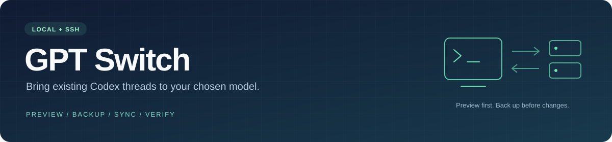

<p align="center">
  
</p>

<p align="center">
  
  
  
  
</p>

<h3 align="center">让已有 Codex 对话跟上你的模型选择</h3>

<p align="center">本地与 SSH 远端批量同步 · 修改预览 · 自动备份 · 占用诊断 · 写入后复核</p>

<p align="center">
  <a href="#快速开始">快速开始</a> ·
  <a href="#ssh-远端同步">SSH 远端同步</a> ·
  <a href="#备份与恢复">备份与恢复</a> ·
  <a href="#常见问题">常见问题</a>
</p>

---

## 为什么需要 GPT Switch？

切换 Codex 的模型或供应商后，新对话可以正常工作，旧对话却仍可能使用创建时保留的模型设置。单独更改全局配置，并不一定会更新已有对话的 `model` 和 `model_provider`。

**GPT Switch** 提供 Windows 图形界面，帮助你核对并批量更新这些字段。既能处理本机数据库，也能通过 SSH 在对应 Linux 主机上执行；每次实际修改前自动生成数据库备份。

> **适用范围**：这是面向 Codex 内部 SQLite 状态库的维护工具，并非 OpenAI 官方产品。它不安装模型、不切换登录账号，也不保证数据库迁移能解决所有认证错误。请保留备份，并在同步后重新连接对应对话。

## 功能一览

| 能力 | 说明 |
| --- | --- |
| **本地批量同步** | 更新当前数据库中的普通对话，包含已归档对话；跳过内部自动审核记录 |
| **SSH 一键修复** | 自动预览，列出待修改数量与占用进程；确认后连续执行备份、停止占用、同步与复核 |
| **目标模型识别** | 通过 Codex `config/read`、`model/list` 获取有效配置和客户端推荐默认值 |
| **自定义模型目录** | 支持 `model_catalog_json`、模型下拉选择，以及直接填写模型 ID |
| **扫描覆盖核对** | 交叉检查数据库、会话文件和侧栏目录索引，区分待修改、已一致、跳过与未入库记录 |
| **实际文件占用检测** | Windows 使用 Restart Manager；Linux 检查同用户进程的文件描述符 |
| **远端进程管理** | 显示 PID 和路径；仅允许结束已核对、实际占用所选数据库的同用户 Codex 进程 |
| **自动备份与事务** | SQLite 一致性备份、完整性校验、并发字段检查及失败回滚 |
| **后台监控** | 最小化后检测占用，满足条件时执行同步；右上角 **X 真正退出** |

## 快速开始

### 1. 准备环境

| 环境 | 要求 |
| --- | --- |
| 本机界面 | Windows，Python **3.11 或 3.12**，推荐 3.12，包含 Tcl/Tk |
| SSH 客户端 | Windows OpenSSH；已配置主机别名和免交互登录 |
| 远端模型发现 / 同步 | Linux，Python **3.10+** |
| 远端占用诊断 | Python **3.6+**；结束进程前的备份需要 Python **3.7+** |

项目仅使用 Python 标准库，**无需 `pip install`**。启动器会优先使用可用的 Codex 随附 Python，其次查找 PATH 中的 `python`。

### 2. 获取并启动

```powershell
git clone https://github.com/hialoha/gpt-switch.git
cd gpt-switch
.\start.cmd
```

也可以下载仓库 ZIP，解压后双击 **`start.cmd`**。

如需直接从终端运行，或查看启动错误：

```powershell
python app.py
```

### 3. 同步本地对话

1. 等待工具识别 Codex 目录、数据库和目标模型。
2. 核对 **模型 / 供应商**；需要时从下拉框自选，或从一条正常对话采用设置。
3. 点击 **预览修改**，查看新旧值；点击 **查看扫描详情** 核对完整扫描范围。
4. 释放数据库占用后，点击 **立即同步全部**。工具先备份，再提交修改。
5. 重新打开或连接对应 Codex 对话，检查是否可以继续工作。

如果暂时不能释放占用，可启用 **后台自动监控**，然后点击 **最小化到后台**。工具不会因为检测到同名 `codex.exe` 就直接拦截，而是检查所选数据库文件的实际持有者。

## SSH 远端同步

SSH 对话的状态库位于对应远端主机。本机侧栏中能看到它，并不表示修改本机数据库就能更新它。

### 首次连接

在终端确认目标别名能够免交互登录：

```powershell
ssh dev-server
```

主机别名来自 `~/.ssh/config`。连接沿用系统 OpenSSH 的 `IdentityFile`、`ProxyJump` 和端口等配置；密码输入及首次主机指纹确认应先在终端完成。

### 推荐：一键修复

1. 在主窗口点击 **SSH 远端同步…**，选择主机。
2. 确认目标模型和供应商。初始值复制自本机界面，也可点击 **使用本机当前目标** 恢复。
3. 点击 **一键修复远端…**。预览窗口会列出主机、数据库、待修改数量，以及将停止的确切 PID 和可执行路径。
4. 核对后点击 **开始：备份 → 停止占用 → 同步 → 复核**。
5. 查看实际修改数、剩余不匹配数和远端备份路径，再重新连接对应 SSH 对话。


**进程处理规则：**

- 默认发送正常退出信号 `SIGTERM`。预览窗口允许你选择：正常退出无效时，强制结束同一批已核对进程。
- 结束进程前先备份数据库；备份失败不发送信号。
- 核对 PID、启动时间、用户、可执行路径及数据库占用。在支持的平台使用 `pidfd` 降低 PID 复用风险。
- 不结束父进程、VS Code，也不自动追杀重启后的新 PID。新进程重新占用时会显示原因并停止写入。
- 停止一个 Codex 后端可能中断它承载的其他对话，预览会列明将处理的进程。

### 分步操作与监控

仍可单独使用 **预览远端全部对话**、**诊断远端占用**、**结束已诊断的远端占用进程…** 和 **备份并同步远端**。

分步同步需要先预览；更换主机、路径或目标后，原预览失效。切换 SSH 主机会清空上次的目录、数据库、扫描结果及占用结果，旧请求晚返回也不会覆盖当前主机。

远端监控每 10 秒检查占用，在释放后同步已预览的当前目标，成功后停止。一次处理一个选中主机。

### 目标来源：本机与远端分开

**检查远端模型** 只显示远端客户端的路径、版本、候选模型和默认值，**不会覆盖当前同步目标**。只有明确点击 **采用上面检查到的远端默认值**，才会改变目标。

远端 PATH 可能指向旧版 CLI。工具优先识别实际持有所选数据库的 Codex 可执行文件；没有活动客户端时，比较已发现的 PATH、VS Code 插件及用户目录中的客户端版本。它不会自动安装或升级 Codex。

`model/list` 的 `isDefault` 表示该客户端和账号下的推荐默认值，不等同于“所有环境的全局最新模型”。

## 模型与配置

没有在 `config.toml` 中显式写 `model` 是正常情况：

1. 优先采用 Codex `config/read` 返回的有效模型配置。
2. 未显式设置模型时，使用 `model/list` 唯一标记为 `isDefault` 的推荐值。
3. 无法确定唯一默认值时，保留选择权，不把候选列表第一项当作默认模型。

如已有 `model_catalog_json`，工具会读取对应 JSON 的 `models[].slug` 作为候选 ID。**模型目录用于提供可选项，`model` 才是配置中的默认模型选择。** 工具不生成或覆盖模型目录，也不把旧式 TOML 模型列表当目录解析。

自选目标只作用于本次数据库同步，不会改写全局配置、登录信息或供应商设置。模型列表中出现某个 ID，也不代表远端推理授权已经验证。

## 备份与恢复

### 备份包含什么？

每次实际更新前，使用 SQLite backup API 生成包含已提交 WAL 内容的完整一致性快照，并执行 `PRAGMA integrity_check`。无变化时不创建同步备份。

```text
gpt-switch-backups/
├── <时间戳>/
│   ├── state_*.sqlite       # 同步前的完整数据库快照
│   └── changes.json         # 原字段与目标值
└── stop-<时间戳>/
    ├── state_*.sqlite       # 停止进程前的完整数据库快照
    └── stop-processes.json  # 已核对的进程与信号记录
```

- 本地备份位于本地数据库旁。
- SSH 备份位于**远端数据库旁**，不会因临时助手清理而删除。
- 成功的远端写操作回执另存本机工具目录的 `ssh-results/`，方便查找远端备份路径。

### 如何恢复？

1. 停止对应主机上占用数据库的程序和 GPT Switch。
2. 另存当前数据库及其 `-wal`、`-shm` 文件。
3. 用备份的 SQLite 文件覆盖原数据库路径。
4. 移走原路径残留的 `-wal`、`-shm` 后，重新启动或连接 Codex。

> 不要把旧 WAL 与恢复后的数据库混用。恢复完整快照会回退备份之后该数据库中的其他变化。SSH 数据库应在原远端主机恢复，不要拿 Windows 本机数据库覆盖远端。

## 扫描与修改边界

| 对象 | 行为 |
| --- | --- |
| 当前数据库的普通 / 已归档对话 | 扫描，仅更新不匹配的 `model`、`model_provider` |
| 内部 `codex-auto-review` 记录 | 计入统计，跳过修改 |
| 空模型值 | 计入待同步范围，不因空值漏检 |
| `sessions/`、`archived_sessions/` | 读取会话元数据 ID，与数据库交叉核对；不改写 JSONL |
| 其他 `state_*.sqlite` 与 `sqlite_home` | 检测并报告；不静默批改未选中的数据库 |
| 本机侧栏的 SSH / ChatGPT 目录索引 | 统计与区分来源，不当作本地可修改对话 |
| 认证、自动化和全局配置 | 不改写 |

Windows 使用 Restart Manager 查询文件占用；Linux 检查同用户 `/proc` 文件描述符。Linux 的部分固定登录服务无法检查时会报告并排除，其余无法检查的同用户进程会阻止写入。**不覆盖其他用户的文件句柄检测**，不建议多用户同时共享写入同一状态库。

## 常见问题

<details>
<summary><strong>新对话可用，旧对话仍提示 API 无效？</strong></summary>

先核对旧对话保留的模型和供应商是否与当前目标一致。同步这两个字段可以处理部分历史设置残留，但不会补齐失效密钥、登录态或远端授权。若字段已经一致，需继续检查认证或客户端配置。

</details>

<details>
<summary><strong>已经关闭 Codex，为什么仍显示占用？</strong></summary>

窗口关闭后，桌面后端、VS Code 插件或其他数据库查看器可能仍持有文件。点击诊断查看实际 PID 和路径。SSH 一键修复可以在确认后停止已核对的 Codex 进程；如果插件自动重启出新 PID，需要先断开该主机的远程 Codex / VS Code 连接。

</details>

<details>
<summary><strong>侧栏对话很多，为什么预览只显示一部分？</strong></summary>

预览表格只列需要改动的记录。扫描详情会分别显示总数、已一致、内部跳过以及本地 / SSH / ChatGPT 目录统计。远端和 ChatGPT 目录项不等同于当前本地数据库中的记录。

</details>

<details>
<summary><strong>SSH 主机只有旧版 Python？</strong></summary>

助手会优先尝试已安装的较新 `python3.x`。占用诊断兼容 Python 3.6；结束进程前备份需要 3.7+，模型发现及数据库同步需要 3.10+。不满足条件时会明确提示，不会自动安装依赖或升级远端环境。

</details>

<details>
<summary><strong>SSH 超时或断网后，要不要立即重试？</strong></summary>

不要盲目重试已发出的写操作。远端事务可能已经完成，只是回执没有返回；先重新预览和诊断，核对字段、进程及备份。关闭主窗口可以取消只读请求，已发出的远端写操作会等待结果，最长约 60 秒。

</details>

<details>
<summary><strong>关闭窗口后会继续运行吗？有托盘或开机自启吗？</strong></summary>

主窗口右上角 X 真正退出；只有点击“最小化到后台”才保留监控。当前没有系统托盘图标或开机自启。重新启动后，监控默认关闭。

</details>

## 项目结构

```text
gpt-switch/
├── app.py                  # 本地图形界面与任务调度
├── remote_ui.py            # SSH 图形界面与修复预览
├── sync_core.py            # 配置、SQLite 备份和事务更新
├── discovery.py            # Codex 官方模型发现协议
├── occupancy.py            # Windows 实际文件占用检测
├── coverage.py             # 扫描覆盖与索引核对
├── ssh_remote.py           # OpenSSH 传输、临时助手与回执
├── remote_agent.py         # Linux 远端预览和同步
├── remote_processes.py     # Linux 进程诊断、校验和停止
├── switch.py               # 保留的本地命令行入口
├── start.cmd / run.ps1      # Windows 启动脚本
├── test_*.py               # 自动化测试与显式实机测试入口
└── docs/assets/            # 文档资源
```

## 开发与验证

运行本地测试：

```powershell
python -m unittest -v test_sync.py test_discovery.py test_occupancy.py test_ssh_remote.py
```

当前包含 **34 项测试**，覆盖默认值解析、扫描覆盖、窗口退出、实际占用、WAL 备份、事务回滚、SSH 状态隔离、过期进程身份拒绝及一键修复流程。

可在你有权限的 Linux 测试主机上显式执行实机验证：

```powershell
python test_ssh_remote.py --live-selftest dev-server
python test_ssh_remote.py --live-stop-selftest dev-server
python test_ssh_remote.py --live-repair-selftest dev-server
```

实机测试创建独立临时数据库及受控测试进程；结束进程测试只处理它自己创建的测试进程，不迁移真实对话。

## 隐私与项目说明

- 不记录或显示 API key，不自行发起模型推理请求；模型发现由 Codex 使用现有配置和认证完成，可能联网刷新目录。
- SSH 助手通过标准输入传入远端临时目录，完成后清理；不安装常驻服务，远端备份会保留。
- 运行回执和扫描报告可能包含主机、路径及进程信息；数据库备份包含对话元数据。仓库已忽略运行回执、数据库、会话、密钥与本机配置文件，请勿主动上传它们。

思路参考 [WangShuai666/codex-model-sync](https://github.com/WangShuai666/codex-model-sync)，本项目围绕本地和 SSH 数据库维护场景独立实现。

相关官方文档：[Codex App Server](https://learn.chatgpt.com/docs/app-server) · [模型目录](https://learn.chatgpt.com/docs/model-catalogs) · [配置参考](https://learn.chatgpt.com/docs/config-file/config-reference)

问题反馈请提交 [Issue](https://github.com/hialoha/gpt-switch/issues)，附上工具版本、操作系统、Python / Codex 版本和脱敏错误信息，避免粘贴密钥或完整数据库。
