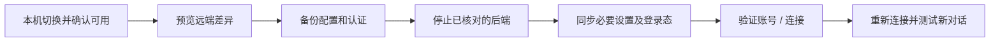

<p align="center"></p>
<h3 align="center">本机切换一次，SSH 远端跟着切换</h3>
<p align="center">连接与登录态同步 · 旧对话迁移 · 修改预览 · 自动备份 · 结果复核</p>
<p align="center">   </p>
<p align="center"><a href="README.md">English</a> | <strong>简体中文</strong> | <a href="README_JA.md">日本語</a> | <a href="README_DE.md">Deutsch</a> | <a href="CHANGELOG.md">更新日志</a></p>
<p align="center"><a href="#快速开始">快速开始</a> · <a href="#跟随本机连接与登录态">连接同步</a> · <a href="#旧对话迁移">旧对话迁移</a> · <a href="#备份与恢复">备份恢复</a> · <a href="docs/TESTING.md">测试说明</a></p>

---

**GPT Switch** 是面向 Codex 本机与 SSH 环境的 Windows 图形维护工具。你在本机用 CC Switch 切换并确认可用后，可以预览差异，将必要连接配置和支持的凭证同步到受信任的 Linux 主机，无需再手工配置远端。

它也支持旧对话的模型/供应商迁移。**连接同步决定新对话用什么；对话迁移修改已经保存的旧对话。两者分开操作。**

> **2.6 为待用户验收的本地测试版，尚未发布。** 本项目不是 OpenAI 官方产品。程序界面目前为简体中文，文档提供中、英、日、德四种语言。仓库克隆得到的是当前已发布版本，不会提前包含这轮未推送修改。

## 功能

| 能力 | 说明 |
| --- | --- |
| 跟随本机连接 | 读取 CC Switch 写入的当前 Codex 配置，只迁移必要连接设置和支持的凭证 |
| 认证与工作区检查 | 区分“文件已写入”“账号检查通过”“凭证仅加载”和 `workspace-401` 等验证失败 |
| 远端独立授权 | 必要时启动 ChatGPT 设备码登录，显示官方页面及一次性验证码，不把验证码写进工具日志 |
| 旧对话批量迁移 | 预览并更新 `model`、`model_provider`，包含已归档对话，跳过内部审核记录 |
| SSH 一键修复 | 确认具体进程后，连续完成备份、停止占用、事务更新和复核 |
| 扫描覆盖核对 | 区分待改、已一致、内部记录、会话文件和本地 / SSH / ChatGPT 索引 |
| 可恢复的修改 | SQLite 一致性快照、受限权限的认证备份、过期状态校验和写入失败回滚 |

## 快速开始

- 本机：Windows，Python **3.11 或 3.12**，含 Tcl/Tk，推荐 3.12。
- 远端：Linux，连接及对话同步需 Python **3.10+**；仅占用诊断兼容 Python 3.6+。
- SSH：Windows OpenSSH，已配置主机别名与免交互登录；首次指纹确认先在终端完成。

```powershell
git clone https://github.com/hialoha/gpt-switch.git
cd gpt-switch
.\start.cmd
```

无需 `pip install`。启动器优先使用可用的 Codex 随附 Python，其次查找 PATH 中的 `python`。调试启动错误可运行 `python app.py`。测试 2.6 时请使用提供给你的本地目录。

## 跟随本机连接与登录态

1. 用 CC Switch 切换，先确认**本机新对话**正常。
2. 主窗口进入 **SSH 远端同步…**，选择主机，再点 **跟随本机连接与登录态…**。
3. 点击 **预览本机 → 远端**，核对目标主机、认证类型、接口和将停止的具体后端。预览只发送指纹，不发送凭证。
4. 点击 **备份并同步配置与登录态**，明确将凭证通过 SSH 发往所选主机。工具先备份，再更新。
5. 查看验证结果，断开并重新连接对应 SSH 项目，再测试**远端新对话**。
6. 如果 ChatGPT 仍报 `workspace-401`，在窗口下方启动设备码授权，打开官方页面输入验证码，完成后再次验证。该登录方式需账号/工作区允许。



### 同步什么，保留什么？

同步模型、供应商、接口、相关登录选项和可选模型目录；支持文件形式的 ChatGPT 缓存及选定供应商 API Key。选定环境变量中的 API Key 会转换为远端文件式 OpenAI-compatible 认证。活动 profile 的旧连接覆盖也会同步处理。

远端项目、MCP、插件、权限/沙箱设置、其他 profile 和无关环境变量保留原有配置值。TOML 会解析后重新序列化，**注释和排版可能变化**，原文件原文有完整备份。

不盲目导出 Windows 凭证库或内存登录态，不复制外部 Windows 认证助手。ChatGPT 账号令牌不迁移到自定义代理配置；本机 HTTP/回环代理地址不能直接当作远端可达地址。

## 旧对话迁移

连接恢复后，如果旧对话仍保留旧供应商，再点 **一键修复远端…**。先查看待改记录与 PID，再执行“备份 → 停止已核对占用 → 更新 → 复核”。不会追杀自动重启后的新 PID，也不结束父进程。

本地对话可用 **预览修改**、**立即同步全部**。已有 401 不一定是模型字段问题：工具不能授予账号工作区权限，也不能保证任意模型有推理授权。验证不发送聊天推理；API Key 检查可能仅表明凭证已加载，需要新对话实测。

## 备份与恢复

| 位置 | 内容 |
| --- | --- |
| `<CODEX_HOME>/gpt-switch-config-backups/<时间戳>/` | 原配置、原登录缓存、恢复清单；停止后端前如有数据库则另存快照 |
| 数据库旁 `gpt-switch-backups/` | 旧对话迁移及结束占用前的数据库快照 |
| 本机工具目录 `ssh-results/` | 脱敏成功回执，不包含凭证同步包 |

远端凭证文件权限为 `0600`，配置备份目录为 `0700`。**备份含可用凭证，只同步到你信任的主机和用户账号，不要上传 Git 或工单。** 登录缓存复制后可能随刷新/过期而分化，必要时使用远端独立授权。

停止相关后端后，可在连接窗口恢复本次已完成同步的配置备份。手工恢复数据库时：停止占用、另存当前 SQLite/WAL/SHM、覆盖快照，再移走原位置残留 WAL/SHM 后启动。完整数据库恢复也会回退备份后的其他变化。

写入中断网时，先重新预览/验证，不能因为没收到回执就立即重试。主窗口 X 会退出、等待已发送写入，并尝试取消已跟踪的设备码登录；网络失败时无法保证远端取消成功。

## 常见问题

- **远端新对话仍走第三方？** 使用连接与登录态同步；仅改旧对话字段不够。检查 profile 及后端启动/环境覆盖。
- **`workspace routing discovery unauthorized (401)`？** 检查远端 ChatGPT 登录和工作区访问；适用时重新做独立设备码授权。复制文件不能补齐账号权限。
- **默认模型还是旧的？** PATH 可能指向旧客户端。工具会显示选择的路径和版本，检查远端默认不会覆盖目标。
- **后端不断重启？** 先断开该主机的 Codex / VS Code 远程连接；工具不会自动结束父进程或新 PID。
- **凭证存在 keyring/认证助手？** 使用支持的文件缓存或远端独立登录，不要把令牌粘贴到 Issue。

## 开发与参考

```powershell
python -m unittest -v test_connection_sync.py test_sync.py test_discovery.py test_occupancy.py test_ssh_remote.py
```

参见 [测试说明](docs/TESTING.md)、[安全说明](SECURITY.md)、[多语言项目描述草稿](docs/PROJECT_METADATA.md)。实机测试使用独立临时目录和虚构凭证，不迁移真实对话，也不导出本机真实登录态。

思路参考 [CC Switch](https://github.com/farion1231/cc-switch) 与 [codex-model-sync](https://github.com/WangShuai666/codex-model-sync)。本工具读取 Codex 的当前配置，不依赖 CC Switch 内部数据库，也不要求远端安装 CC Switch。

官方文档：[认证](https://learn.chatgpt.com/docs/auth) · [App Server](https://learn.chatgpt.com/docs/app-server) · [配置](https://learn.chatgpt.com/docs/config-file/config-reference)。反馈请附版本及脱敏错误，不要附密钥、`auth.json`、数据库备份或完整登录日志。
